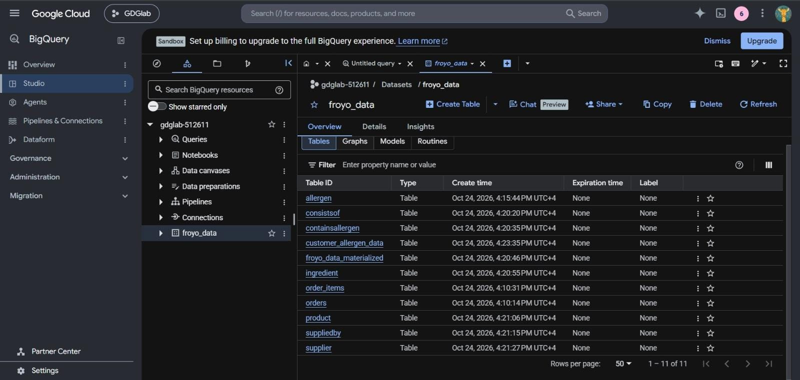
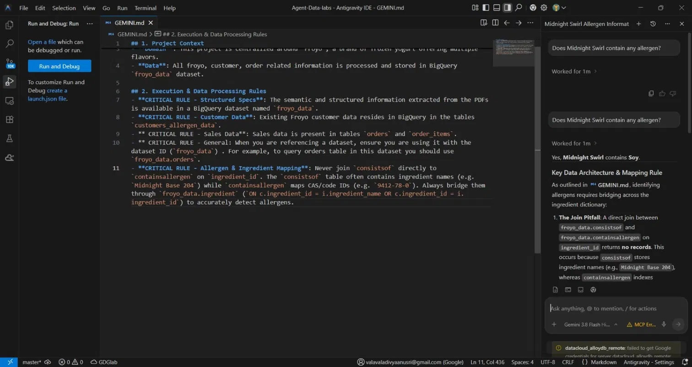
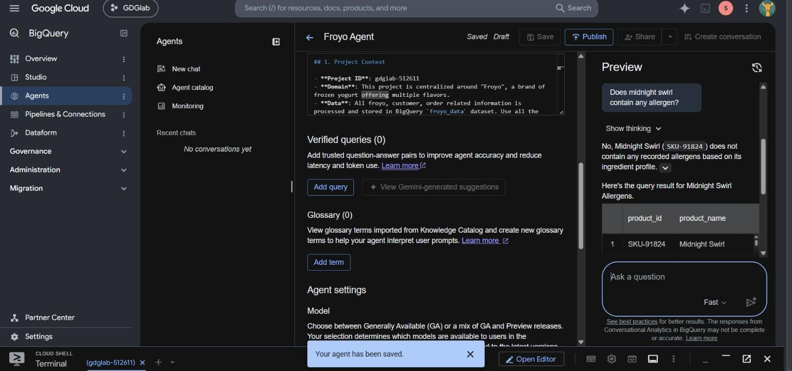

# Agentic Data Analytics with Google Cloud BigQuery & Antigravity

A hands-on implementation of Google's Agentic Data Codelab, exploring how AI agents make business data accessible through natural-language conversations.

## Project Overview

Traditional data analytics requires users to understand SQL and database structures. This project explores a conversational approach: ask business questions in plain English and get data-driven answers from BigQuery.

The scenario is a fictional frozen-yogurt business, **Froyo**.

## Technologies Used

- Google Cloud Platform
- Google BigQuery (Data Agents / Conversational Analytics)
- Google Antigravity IDE
- Google Cloud Data Agent Kit
- Gemini
- SQL

## Dataset

The BigQuery dataset `froyo_data` contains 11 tables: `allergen`, `consistsof`, `containsallergen`, `customer_allergen_data`, `froyo_data_materialized`, `ingredient`, `order_items`, `orders`, `product`, `suppliedby`, `supplier`.

The sales and customer CSV files come from the codelab author's repository and are not redistributed here.

## What I Built

### 1. IDE-first analytics (Antigravity + Data Agent Kit)

I installed the Data Agent Kit extension in Antigravity IDE and added a `GEMINI.md` file ([see file](GEMINI.md)) that gives the agent the project context, dataset name and data-processing rules.

Asking *"Does Midnight Swirl contain any allergen?"* correctly returned **Soy**.

### 2. BigQuery Data Agent ("Froyo Agent")

I created a Data Agent in the BigQuery console, attached the dataset tables as knowledge sources, accepted the generated table and field descriptions, and added custom instructions based on `GEMINI.md`. The agent is saved as a draft.

## Challenges & Learnings

**Inconsistent allergen answers between the IDE agent and the console agent.**

For the same question about Midnight Swirl, the IDE agent returned Soy, while the console Data Agent initially reported no recorded allergens.

The IDE agent's explanation pointed to the cause: `consistsof` stores ingredient *names* (e.g. `Midnight Base 204`) while `containsallergen` is indexed by ingredient *IDs/CAS codes*, so a direct join returns no rows. The correct path bridges them through the `ingredient` table. This rule is in my `GEMINI.md`; the console agent's instructions need the same rule.

**Key takeaway:** agent accuracy depends heavily on explicit instructions about join logic and data quirks. The same data can give different answers depending on the instructions each agent is given.

## Next Steps

- [ ] Add the ingredient-bridging rule to the console agent instructions and re-test
- [ ] Run the "top 5 products bought by customers with a Dairy allergy" query
- [ ] Try BigQuery ML sales forecasting
- [ ] Publish the agent and explore Data Studio

## Project Reference

Completed as a hands-on implementation of the official Google Codelab: [Chat With Your Data using BigQuery Agents & Antigravity IDE](https://codelabs.developers.google.com/data-agents-in-agy-and-bq).

**Attribution:** Original learning material and codelab by Google. Replace `<YOUR_PROJECT_ID>` in `GEMINI.md` with your own project.

## Project Status

Codelab setup completed (IDE agent working, console agent configured as draft). Remaining items listed under Next Steps.
